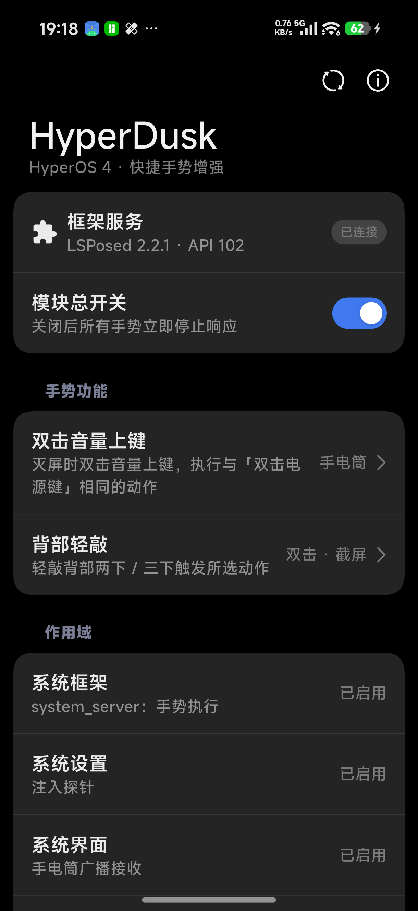
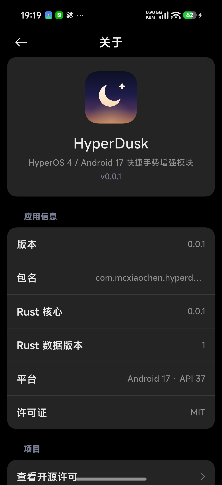

# HyperDusk

[](https://github.com/mcxiaochenn/HyperDusk/actions/workflows/verify.yml)
[](LICENSE)
[](https://github.com/mcxiaochenn/HyperDusk/releases)

面向 **HyperOS 4.0 / Android 17（API 37）** 的独立 [libxposed](https://github.com/libxposed) 模块。它不替换任何系统应用，只是在系统设置「辅助功能 → 快捷手势」里补上两项原生缺失的手势能力。

<p align="center">
  
</p>

## 功能

### 背部轻敲 → 手电筒

- 位置：设置 → 辅助功能 → 快捷手势 → 背部轻敲。
- 模块给「轻敲两下 / 轻敲三下」的下拉列表补上系统漏掉的「手电筒」选项；选中后敲击背部即可开关手电筒。
- 手电筒仍由系统执行：`system_server` 侧发出 `miui.intent.action.TOGGLE_TORCH`（`IS_TOGGLE=true`），SystemUI 的 `MiuiFlashlightControllerImpl` 控制 LED，模块不直接碰硬件。
- 系统原本会在开机/切换用户时把背部轻敲上的 `turn_on_torch` 改写成 `none`，模块拦下了这一步，配置能长期保留。

### 快捷手势 → 双击音量上键

- 位置：设置 → 辅助功能 → 快捷手势 → 「双击音量上键」（模块新增的一行）。
- 点进去的二级菜单直接复用「双击电源键」页面，选项与该页保持一致（相机 / 手电筒 / 公交·Mi Pay·门卡 / 小米一指连 / 无操作，具体以系统当前配置为准）。
- 触发条件与系统「双击音量下极速相机」同款：只有**灭屏**（含 AOD）时双击音量上键才执行所选动作，触发前先唤醒屏幕；亮屏（包括锁屏未解锁）不触发；媒体播放 / 通话中不触发。
- 配置存在 `Settings.System` 的 `hyperdusk_double_click_volume_up`，不占用系统原生键位：

```bash
adb shell settings get system hyperdusk_double_click_volume_up
```

## 安装

前提：HyperOS 4.0 / Android 17 真机 + 实现了 libxposed API 102 的框架（LSPosed 2.x / Vector 2.2 等），且框架支持 `system_server` 注入（`PROP_CAP_SYSTEM`）。

1. 从 [Releases](https://github.com/mcxiaochenn/HyperDusk/releases) 下载 `app-release.apk` 安装。release 使用固定签名，后续版本可直接覆盖升级。
2. 在 LSPosed / Vector 里启用 HyperDusk。作用域由模块固定为四项，不需要也不能手动增删：
   - `system`（`system_server`，手势执行）
   - `com.android.settings`（注入探针）
   - `com.android.systemui`（手电筒广播接收）
   - `com.miui.securitycore`（快捷手势页注入）
3. 重启手机，让 `system_server` 与 `com.miui.securitycore` 重新注入。
4. 打开系统设置里的对应入口配置手势。

升级模块 App 后，Hook 代码需要重装 APK + 重启手机（或至少重启对应系统进程）才会生效：`module.prop` 里是 `autoHotReload=false`。

## 模块 App

模块 App 本身不参与注入（libxposed API 101 起的既定行为），它是一个 HyperOS 风格的状态页 / 设置页，用 [flutter_miuix](https://pub.dev/packages/flutter_miuix) 构建：

- 展示框架连接状态、模块总开关、当前两个手势的配置值；
- 一键直达系统设置里的「快捷手势」与「背部轻敲」；
- 「关于」页给出运行信息（版本、包名、Rust core 版本、平台、许可证）；
- 总开关关闭后，两个手势在 `system_server` 侧立即停止响应，不需要重启。

页面结构是 miuix 的「小标题 + 分组卡片 + 列表行」：状态卡（框架服务 / 模块总开关）、手势功能卡（两行可点项，行尾直接显示当前动作）、作用域卡（四项各自说明注入作用）、关于卡。

<p align="center">
  
  
</p>

<p align="center"><sub>截图来自 Xiaomi 17 Pro（HyperOS 4 / Android 17，深色模式）</sub></p>

## 构建与验证

构建全部交给 CI（[`.github/workflows/verify.yml`](.github/workflows/verify.yml)），本地只做代码修改与静态检查。CI 每次 push 会跑：

1. `flutter_rust_bridge_codegen generate` + `cargo fmt` + `dart format`，生成物与仓库无 diff；
2. Rust：`cargo fmt --check` / `cargo test` / `cargo clippy -D warnings`；
3. Flutter：`flutter analyze` / `flutter test`；
4. legacy 污染符号扫描（禁止旧项目标识符）；
5. debug + release 双 APK 构建；
6. 签名证书 SHA-256 指纹校验（漂移即失败）；
7. APK 结构审计：xposed 三件套、双 ABI 的 `libhyperdusk_core.so`、`scope.list` 必须恰好四行、`java_init.list` 入口类真实存在于 dex。

本机常用命令：

```powershell
flutter pub get
flutter analyze
flutter test
```

打 tag `v*` 时，同一个 workflow 会额外把 release APK 发布到 GitHub Releases。

### 签名

- **debug**：固定使用仓库内的 `android/app/debug.keystore`（别名 `androiddebugkey`），不同次构建签名一致，可直接覆盖安装。
- **release**：keystore 不进仓库。CI 从 GitHub Secrets（`RELEASE_KEYSTORE_BASE64`、`RELEASE_KEYSTORE_PASSWORD`、`RELEASE_KEY_ALIAS`、`RELEASE_KEY_PASSWORD`）解码到临时目录后交给 Gradle，并校验证书指纹。
- 本地构建 release 时设置 `RELEASE_KEYSTORE_FILE` / `RELEASE_KEYSTORE_PASSWORD` / `RELEASE_KEY_ALIAS` / `RELEASE_KEY_PASSWORD` 即可使用正式签名；未设置时 release 退化为 debug 签名，仅供本地验证。

## 已知限制

- **双击音量上键会同时留下两次音量步进**：检测方式是旁路观察、不吞按键，和系统「双击音量下极速相机」的既有行为一致。
- **背部轻敲只在亮屏时可用**：sensor 由系统在亮屏时注册，模块没有改变这一点。
- **国际版未适配**：国际版「双击电源键」页会直接关闭，因此「双击音量上键」入口只在非国际版注入。
- **依赖 securitycore 内部实现**：部分类名 / 成员被混淆（本版按 securitycore `4.4.4.4-4-260914` 的逆向结果实现），系统升级后 UI 注入可能失效；代码带运行时结构守卫，失效时降级不崩。
- **模块 App 只做状态展示与跳转**：具体手势动作仍在系统设置里配置，不在 App 内改。

## 项目结构

```
lib/                        Flutter UI（状态页、设置页、动作名映射）
rust/                       Rust core（初始化状态、应用信息），经 flutter_rust_bridge 暴露给 UI
android/app/src/main/kotlin/com/mcxiaochen/hyperdusk/
  HyperDuskModule.kt        libxposed 入口，按进程/包名分发
  SystemServerHooks.kt      system_server：背部轻敲 → 手电筒
  VolumeUpDoubleClickHook.kt system_server：双击音量上键
  SecurityCoreHooks.kt      securitycore：快捷手势/背部轻敲列表注入、配置读写
  GestureShortcutUiHooks.kt 快捷手势页注入「双击音量上键」行
  DoubleClickPowerKeyUiHooks.kt 二级菜单复用双击电源键页面
  BackTapTorchOptionHook.kt 背部轻敲下拉注入「手电筒」
  HyperDuskPrefs.kt / HyperDuskApplication.kt / MainActivity.kt  配置与 App 桥接
tools/icon/generate_icon.py 图标生成脚本（Pillow，产物为自适应图标三层）
```

模块边界：

- API：libxposed 102（`minApiVersion=102`、`targetApiVersion=102`、`exceptionMode=protective`、`staticScope=true`、`autoHotReload=false`）
- Java 入口：`com.mcxiaochen.hyperdusk.HyperDuskModule`（`java_init.list` 仅此一行）
- applicationId：`com.mcxiaochen.hyperdusk`；`compileSdk` / `minSdk` / `targetSdk` = 37；ABI：`arm64-v8a`、`x86_64`

## 环境

- Flutter 3.47.1 / Dart 3.13.1
- Rust 1.98.0
- JDK 21+、Android SDK 37、Android NDK 28.2.13676358
- flutter_rust_bridge 2.14.0-beta.2、flutter_miuix 1.3.0

## 致谢

- [libxposed](https://github.com/libxposed) —— 模块 API 与 service 桥接
- [flutter_miuix](https://github.com/ChuxinNeko/flutter_miuix) —— HyperOS 风格 Flutter 组件库
- [flutter_rust_bridge](https://github.com/fzyzcjy/flutter_rust_bridge) —— Dart ↔ Rust 绑定

第三方组件的完整许可信息见 [THIRD_PARTY_NOTICES.md](THIRD_PARTY_NOTICES.md) 和 App 内的「查看开源许可」。

## 许可证

[MIT](LICENSE) © 2026 HyperDusk Contributors
